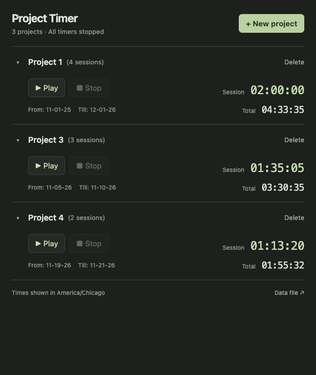
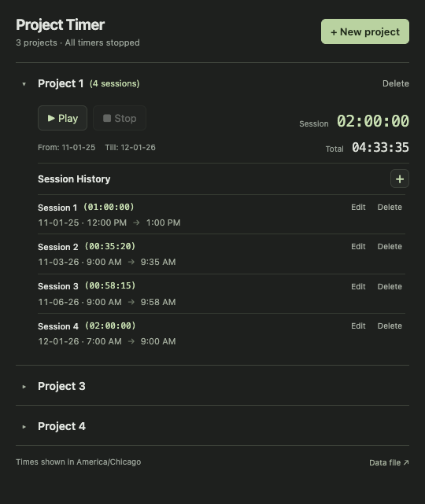

# Project Timer

During the first semester of my freshman year, many of my assignments asked me to estimate how long a project would take and then report how much time I actually spent on it. The idea was to help us learn to estimate our work and manage our time before getting into production development, where figuring out how long something will take can be difficult. A project estimated at 20 hours can easily turn into 40.

I would often forget how much time I had spent on a project because I didn't have a good way to track it. So, in Week 14, I spent a little time looking into what it would take to build something that did what I needed.

This is my little, simple project timer.


## About the app

Project Timer is a simple desktop timer for tracking how much time you spend on projects and labs. Start a timer when you work, stop it when you take a break, and see both your latest session and the total time spent on each project.

Everything is saved locally on your Mac. No account is needed, and the app works offline after installation.

**macOS only. Mobile, Windows, and Linux support are not included and will not be added.**

## Features

- Track multiple named projects, with separate timers and session histories.
- See session and project totals in hours, minutes, and seconds (`HH:MM:SS`).
- View the first start date and most recent stop date for each project.
- Add forgotten sessions, correct recorded times, or delete sessions you no longer need.
- Collapse projects to save space; the app remembers which ones you collapsed.
- Move and resize the window, or keep it above other windows with **Always on Top**.
- Save screenshots and report problems from the **Support** menu.
- Save your work automatically and recover recorded time after an unexpected shutdown.

## Screenshots

**No projects yet**


**Project timers**



**Session history**



## Getting started

You need **macOS 13+**, **Node.js 22.12+**, and **Yarn Classic 1.x** to install or run the app from this repository.

Download or clone [Project Timer](https://github.com/wells19d/ProjectTimer), then open a terminal in the project folder. The initial installation needs internet access; everyday use does not.

### Install as a Mac app

Run:

```sh
yarn install
yarn build:mac
```

This installs **Project Timer.app** in your **Applications** folder. Open it from Applications, Spotlight, or the Dock. After installation, you can launch it without opening a terminal or an IDE.

### Run from VS Code or a terminal

Open the project folder in VS Code and use its integrated terminal, or open a regular terminal in that folder:

```sh
yarn install
yarn start
```

Both options launch the desktop app. The installed copy and the copy you run from the project folder keep separate project data.

### Update the installed app

Quit Project Timer, download or pull the updated source, then run these commands from the project folder:

```sh
yarn install
yarn build:mac
```

Your installed projects and recorded times are preserved. Use this command to update the app; replacing it manually in Finder skips that preservation step. A first-time installation starts with no projects.

## Using the timer

1. Click **+ New project**, enter a name, and choose **Create project**.
2. Press **Play** when you begin working.
3. Press **Stop** when you take a break or finish.
4. Press **Play** again to begin another session on the same project.

**Session** shows the current or most recent session. **Total** adds together every session for that project. Both show hours, minutes, and seconds. **From** is the first start date; **Till** is the most recent stop date.

Click a project name to rename it. Use the arrow beside its name to collapse or expand it. **Delete** asks for confirmation before removing the project and all its sessions; choose **Cancel** or press **Escape** to keep them.

Projects can run at the same time. Minimizing the window leaves timers running, including while your Mac sleeps. Closing the app stops all timers and saves their final times. If a save fails, the app stays open and shows an error.

After a crash or force-quit, unfinished timers are stopped at their last recovery point, normally saved about every five seconds while a timer runs. Time after that recovery point may be lost.

### Review and correct sessions

Click a project's **session count** to open its history beneath the timer. Other projects temporarily collapse; click the count again to close history and restore their previous states.

Each session shows its duration, date, and start/end times. Times use your local timezone, shown at the bottom of the window. Long histories have previous/next arrows to browse 25 sessions at a time.

**Stop that project's timer before making session changes.** Other projects can keep running.

- **+** adds a missing session. Enter its start and end; no name is needed.
- **Edit** changes an existing session's start and end.
- **Delete** removes a session after confirmation.

Sessions stay in date order. Added or edited times cannot overlap another session in the same project. If they overlap, choose different times or edit the existing sessions yourself. One session can end at exactly the time another begins.

Saved changes immediately update the project's session count, totals, and dates.

### Window and support options

Move and resize the window to fit your workspace. Content scrolls when needed.

- **Window → Always on Top** keeps the timer above other windows. Uncheck it to turn this off.
- **Support → Save Screenshot…** saves the visible app contents as a PNG. You can also press **⌘⇧S**.
- **Support → Report a Problem…** opens the [GitHub issues page](https://github.com/wells19d/ProjectTimer/issues). Include your app version, what happened, and a screenshot if helpful.
- **Project Timer → About Project Timer** shows your app version.

## Your saved data

Your projects and times are saved automatically on your Mac. Click **Data file ↗** to reveal your `projects.json` file in Finder. You can copy this file somewhere safe as a backup.

Use the session history controls for everyday corrections. If you choose to edit the saved file directly, quit the app first and make a backup before changing anything.

## Open source

I'm keeping this project open source. Feel free to fork it and make adjustments to fit your needs. If you share your version, please include a credit and a link to the original [Project Timer repository](https://github.com/wells19d/ProjectTimer) in your README.

## Versions

### 1.0.0

- Initial release.

### 1.0.1

- View, add, edit, and delete sessions directly beneath each project.
- Browse long session histories and prevent overlapping times.
- Confirm deletions inside the app.
- Save screenshots, report problems, and keep the window above other apps.
- Clearer dates and times, a more compact layout, and reduced background activity.
- Preserve existing projects when updating the installed app.
