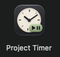
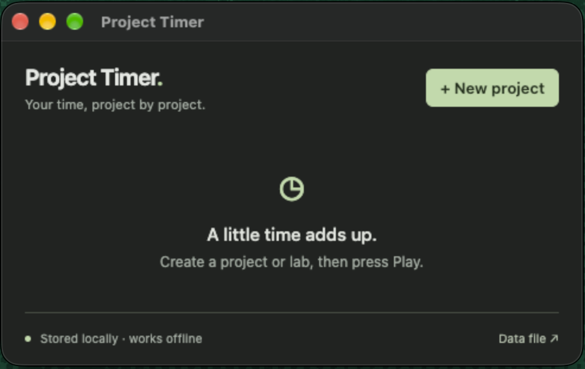
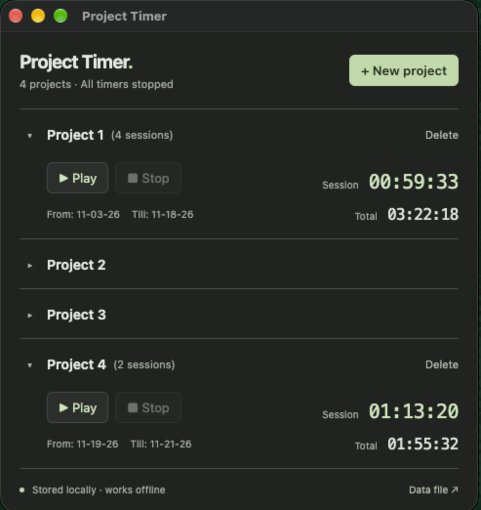

# Project Timer

During the first semester of my freshman year, many of my assignments asked me to estimate how long a project would take and then report how much time I actually spent on it. The idea was to help us learn to estimate our work and manage our time before getting into production development, where figuring out how long something will take can be difficult. A project estimated at 20 hours can easily turn into 40.

I would often forget how much time I had spent on a project because I didn't have a good way to track it. So, in Week 14, I spent a little time looking into what it would take to build something that did what I needed.

This is my little, simple project timer.


## What it does

Project Timer is a small, offline desktop app for tracking time spent on projects and labs. Create a project, press Play when you start working, and press Stop when you take a break or finish. It keeps each work session and adds them together so you can see how much time the whole project took. Times display as `HH:MM:SS`.

It is built with JavaScript and Electron and saves everything locally in readable JSON. No account or server is needed.

**This project is for macOS only. Mobile, Windows PC, and Linux support are not included and will not be added.**

## Screenshots

**App icon**



**No projects yet**



**Four projects, with two collapsed**



## Using the timer

- **New project** creates a named project with no time recorded.
- **Play** starts a new time block. **Stop** ends it.
- **Session** shows the current or most recent time block.
- **Total** adds all time blocks for that project.
- **From / Till** show the first start date and most recent stop date.
- Click a **project name** to rename it.
- Use the **arrow** to collapse or expand a project. It remembers your choice.
- **Delete** asks before removing a project and all its times.

Projects can run independently. Closing the app stops all timers; minimizing it leaves them running. After a crash, unfinished timers stop at the last saved heartbeat, which updates every five seconds while a timer runs.

Move and resize the window as needed. Once you resize it manually, it keeps your chosen size for that launch and scrolls if needed.

## Setup

You need **macOS 13+**, **Node.js 22.12+**, and **Yarn Classic 1.x**. Clone or download this repository before following either option below.

The first install needs internet access to download dependencies. After that, the app works offline.

### Run from an IDE or terminal

Open the project folder in VS Code, open its integrated terminal, and run:

```sh
yarn install
yarn start
```

After installing dependencies, you can also select **Run and Debug → Project Timer** and press **F5** in VS Code. Other IDEs can run the same terminal commands from the project folder.

This launches the desktop window. Start it with `yarn start`, rather than opening the HTML file in a browser. You can also use a regular terminal without an IDE.

### Install in Applications

If you'd rather launch it like a regular Mac app, open a terminal in the project folder and run:

```sh
yarn install
yarn build:mac
```

Quit any running copy of the timer before building. This builds and installs **Project Timer.app** in `/Applications`. Open it from Applications, Spotlight, or the Dock. No IDE or terminal window is needed when launching the installed app.

Run `yarn build:mac` again after changing or updating the code to update the installed app. If Applications is not writable, the finished app is also in `dist/` for you to move with Finder.

Both `yarn start` and the installed app use the same time history. Quit one before opening the other.

## Your data

Time history is stored in **`data/projects.json`**. Click **Data file ↗** in the app to find it.

**Quit the app before editing the JSON**, and make a backup first. Each block has a `start` and `end` timestamp, for example:

```json
{
  "start": "2026-11-22T09:00:00-06:00",
  "end": "2026-11-22T10:30:00-06:00"
}
```

Keep blocks in time order, with no overlaps within a project. Totals are calculated from these blocks when the app opens.

The installed app points to this project's data folder. Keep that folder in place even if you move the app to the Dock or Applications. If you move the project folder, rebuild the app to update its data path.

An earlier build could save data inside the `.app` instead. Updating now backs up that history under `data/legacy-app-backup-…/` and imports it if the external project list is empty. Existing external projects are kept.

## Sharing the source

`data/`, `node_modules/`, and `dist/` are excluded from Git. Include the source, `assets/`, `package.json`, and `yarn.lock` when sharing the project.

Each person should install dependencies and build their own Mac app. The current build uses this Mac's architecture and an absolute local data path; it is intended for personal use rather than sharing as a prebuilt installer.

## Development

```sh
yarn test       # Run automated tests
yarn run check  # Check JavaScript syntax
```

The app code is in `src/`, build scripts are in `scripts/`, and the icon is in `assets/`. The build automatically prepares the Mac icon. To build without installing, use `yarn build:mac --package-only`.
